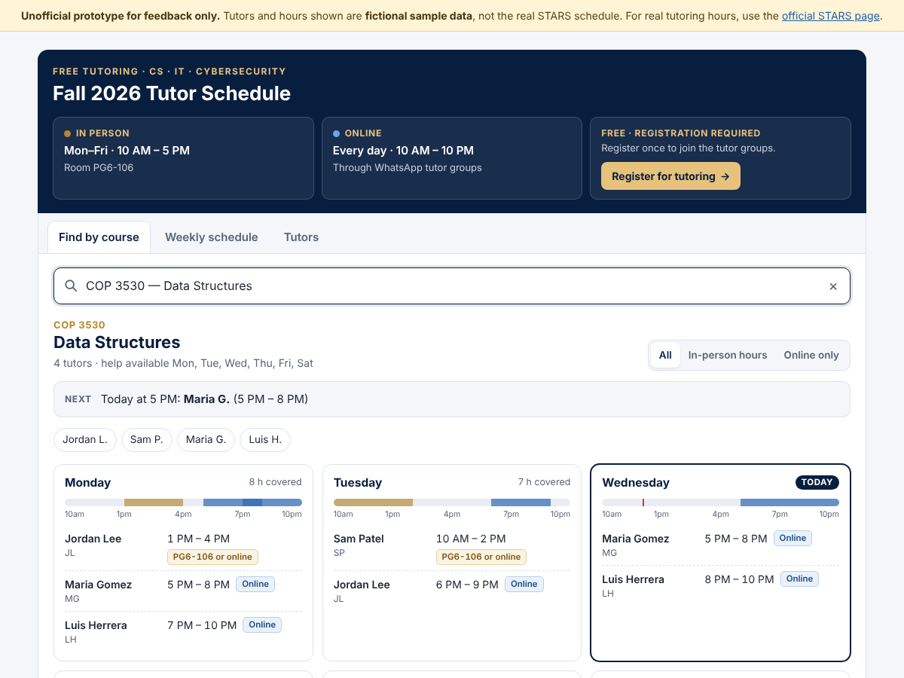
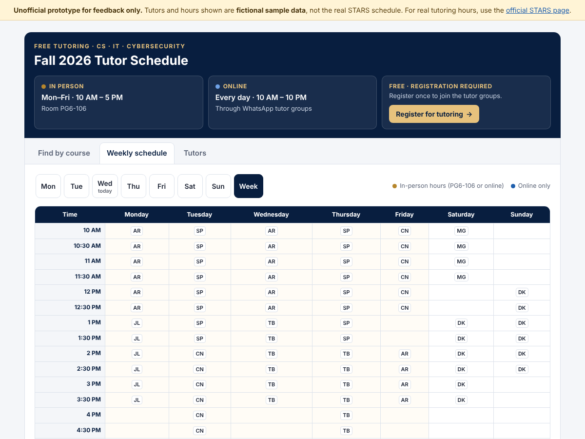
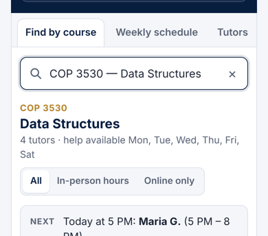

# STARS Tutor Schedule Redesign

A searchable, mobile-friendly replacement for the FIU STARS tutor schedule. Students pick a course and see which tutors cover it, when they're available, and whether the slot is in person or online.

**[Live demo (sample data)](https://bsemidey.github.io/stars-tutor-schedule/)**



> **Unofficial student prototype.** All tutors and hours in this repo are **fictional sample data**. This is not the official STARS schedule. For real tutoring hours, see [stars.cs.fiu.edu/tutor-schedule](https://stars.cs.fiu.edu/tutor-schedule/).

## The problem

STARS publishes its tutor schedule as two static images: a weekly grid of tutor initials and a separate course-coverage chart. To answer *"who can help me with Data Structures, and when?"*, a student has to:

1. Find the course in the coverage chart and note which initials are checked.
2. Switch to the weekly grid and scan every day for those initials.
3. Work out the time ranges by hand.

The images can't be searched or zoomed well on a phone, and screen readers can't read them. The schedule also doesn't say whether a tutor is in the room or online during in-person hours.

## The solution

One self-contained HTML/CSS/JS file that reads the **same two spreadsheet tabs** staff already maintain, exported as CSV:

- **Find by course:** search by number (`3530`), code (`COP 3530`), or name (`data structures`). It shows who covers the course, a **Now / Next** indicator, and a daily timeline for each tutor.
- **Filters:** in-person hours vs. online only, or a single tutor.
- **Weekly schedule:** one day at a time on phones, or the full-week grid on desktop.
- **Tutors:** each tutor's hours and courses. Tap a course to jump to it.
- **Shareable links:** e.g. `#stars-course=COP3530`.
- **Staff data check:** add `#stars-check` to the URL to flag unknown initials, tutors with no hours, and courses with no tutor.

| Weekly grid | Mobile |
|---|---|
|  |  |

### Built for handoff

- **No build step and no dependencies.** The whole widget pastes into a single WordPress *Custom HTML* block.
- **Scoped CSS** (`#stars-sched`) so it can't clash with the site's theme, and the theme can't restyle it.
- **Updating each semester means updating spreadsheets, not code.** Staff export the two tabs as CSV and either paste them into the marked sections or point the config at hosted CSV links.
- **Accessible:** keyboard-navigable search (combobox), ARIA tabs, visible focus states, and reduced-motion support.

## My role

- **Problem discovery:** as a STARS tutor, I saw students struggle to read the image-based schedule, especially on their phones.
- **Success metrics:** defined how we'd measure improvement: time to find a tutor for a given course, task success rate, and mobile usability.
- **Scoping:** scoped the first release with a 3-person team around one core job: *"pick a course, see who can help and when."*
- **Prototyping:** built this working prototype using AI-assisted development (Claude), parsing the real spreadsheet format so no new workflow is needed.
- **Validation plan:** designed a 21-question usability survey that compares task success on the current page vs. the prototype. The two versions use different tasks so participants can't reuse answers.

## Status

- [x] Working prototype parsing the real schedule spreadsheet format
- [x] Tested at desktop and phone widths inside a mock of the site's WordPress theme
- [ ] Supervisor review and approval
- [ ] Usability survey (target: 20+ responses)
- [ ] Handoff to STARS staff

## Results

_To be added after the usability survey: time-to-find and task success, current page vs. prototype._

## Repo structure

```
index.html                  Demo page (prototype banner + widget with sample data)
stars-tutor-schedule.html   The paste-into-WordPress widget
schedule.csv                Fictional weekly grid, same layout as the real workbook tab
coverage.csv                Fictional course coverage, same layout as the real workbook tab
*.png                       Screenshots
```

## Run it locally

Download the repo and open `index.html` in any browser. That's it.
